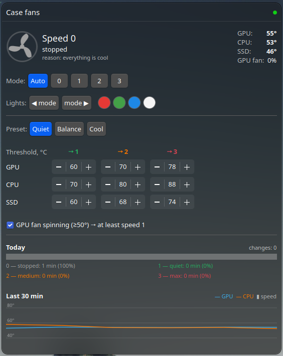

# coolmoon-rf433

Control a **Coolmoon RGB fan hub** (the one with a 433 MHz RF remote) from a PC:
an ESP32 + CC1101 running ESPHome imitates the remote, a small Linux service
picks the fan speed from CPU / GPU / SSD temperatures, and a KDE Plasma widget
shows what is going on.

Goal: the quietest PC possible — case fans stopped at idle, spinning up only when
something actually gets warm.

<p align="center">
  
  &nbsp;
  
</p>

[Русская версия ниже](#по-русски)

## What's inside

| Path | What |
|---|---|
| [`codes.json`](codes.json) | All 21 decoded remote codes |
| [`esphome/`](esphome) | ESPHome config: ESP32 + CC1101 transmitter with a button per remote key |
| [`fanctl/`](fanctl) | Python service: temperature → fan speed, local HTTP API |
| [`kde/`](kde) | Plasma 6 widget (EN / RU, follows the system language) |

## The remote protocol

Captured with ESPHome `remote_receiver` + `rc_switch` dump:

- 433.92 MHz, ASK/OOK, **RCSwitch protocol 1**, pulse ≈ **410 µs** (short ≈ 420 µs, long ≈ 1240 µs);
- 24-bit code = **16-bit remote address** + **8-bit command**;
- the command number is simply the button's position on the remote, 1…21;
- the hub ignores a single burst — send it **~10 times in a row** (the real remote repeats while the key is held).

My remote's address is `1100111110110111`. **Yours is almost certainly different** — see
[Learn your remote](#learn-your-remote).

| # | Button | # | Button | # | Button |
|---|---|---|---|---|---|
| 01 | on | 08 | mode − | 15 | orange |
| 02 | auto | 09 | brightness − | 16 | orange 2 |
| 03 | off | 10 | R | 17 | blue |
| 04 | speed + | 11 | G | 18 | lilac |
| 05 | mode + | 12 | B | 19 | violet |
| 06 | brightness + | 13 | green-yellow | 20 | green |
| 07 | speed − | 14 | yellow | 21 | white |

Hub behaviour worth knowing:

- 4 fan speeds: **0 (stopped)**, 1, 2, 3. Only relative `speed +` / `speed −`, no "set speed N".
- Speed **clamps at both ends** (no wrap-around): `speed −` ×4 always gives 0. This is how
  fanctl re-syncs when it is unsure about the current speed.
- With `off` (lights off) the hub **ignores speed commands** — fanctl always sends `on` first.
- `auto` only cycles the lighting effects.

## Hardware

<p align="center"></p>

Tested with this one: **Coolmoon "Controller of Rainbow RGB Fan"** (up to 10 fans + 2 LED strips,
Molex power) and its 21-key 433 MHz remote.

- ESP32 DevKit (any ESP32 with ESPHome support)
- CC1101 433 MHz module, 8-pin (2×4 header) — **3.3 V only**
- The Coolmoon hub and its fans, of course

Pins on the common 2×4 CC1101 module (pins 1–2 at one edge, 7–8 at the other):

```
 2 VCC    4 CSN    6 MOSI   8 GDO2
 1 GND    3 GDO0   5 SCK    7 MISO
```

| CC1101 | ESP32 |
|---|---|
| 1 GND | GND |
| 2 VCC | 3V3 |
| 3 GDO0 | GPIO4 (TX data) |
| 4 CSN | GPIO18 |
| 5 SCK | GPIO5 |
| 6 MOSI | GPIO23 |
| 7 MISO | GPIO19 |
| 8 GDO2 | GPIO16 (RX data) |

SCK/CSN are swapped compared to the usual VSPI pins only because that's how my wires ended up —
any pins work, just change them in the YAML. If ESPHome logs `CC1101 found! Chip ID: 0x0000` /
`Failed to verify CC1101`, the wiring is wrong (most often SCK/CSN or MISO/MOSI); a working module
reports `Chip ID: 0x0014`. 10 dBm (the default) was plenty for 2–3 m through a wall.

## ESPHome

```sh
cd esphome
cp secrets.yaml.example secrets.yaml   # fill in Wi-Fi + generate keys
esphome run coolmoon-rf433.yaml        # first flash over USB, later OTA
```

Uses the built-in [`cc1101`](https://esphome.io/components/cc1101/) component (ESPHome 2025.12+),
in "dual pin" mode: transmit on GDO0, receive on GDO2, `on_transmit: cc1101.begin_tx` /
`on_complete: cc1101.begin_rx`. Each remote key becomes a `button` in Home Assistant /
the ESPHome API.

### Learn your remote

1. In `coolmoon-rf433.yaml` uncomment `dump: [rc_switch]` under `remote_receiver`, flash.
2. Watch `esphome logs coolmoon-rf433.yaml`, press any key on your remote, hold ~1 s.
3. You'll see `Received RCSwitch Raw: protocol=1 data='XXXXXXXXXXXXXXXX000001xx'`.
   The first 16 bits are your address — put them into `remote_address` in `substitutions`.
4. Comment the dump out again (it floods the log with 433 MHz noise).

If nothing shows up, try `dump: all` — and check the remote really is 433 MHz (some are 315 MHz).

## fanctl — the service

Reads temperatures every 2 s (CPU: `coretemp`/`k10temp`, NVIDIA GPU via `nvidia-smi`,
NVMe via hwmon), averages over 10 s, and picks the speed by the hottest sensor:

| Preset | GPU | CPU | SSD |
|---|---|---|---|
| Quiet | 60 / 70 / 78 | 70 / 80 / 88 | 60 / 68 / 74 |
| Balance | 55 / 65 / 75 | 65 / 75 / 85 | 55 / 65 / 72 |
| Cool | 48 / 58 / 68 | 58 / 68 / 78 | 50 / 60 / 68 |

(°C at which speed 1 / 2 / 3 kicks in. Thresholds can be edited in the widget → "Custom".)

- Up immediately; down only after 30 s at least 6 °C below the threshold, and never sooner
  than 30 s after the previous change — no flapping.
- Optional rule: while the GPU's own fan spins and the GPU is ≥ 50 °C, case fans stay ≥ 1.
- Manual mode: fixed speed 0–3 (no overheat protection while in manual!).
- No sensor data → speed 3.
- ESP connection loss is detected and shown; it reconnects by itself.

Install (user service):

```sh
mkdir -p ~/.local/share/fanctl && cp fanctl/fanctl.py ~/.local/share/fanctl/
python3 -m venv ~/.local/share/fanctl/.venv
~/.local/share/fanctl/.venv/bin/pip install -r fanctl/requirements.txt
cp fanctl/fanctl.env.example ~/.config/fanctl.env && chmod 600 ~/.config/fanctl.env   # set host + api key
cp fanctl/fanctl.service ~/.config/systemd/user/
systemctl --user daemon-reload && systemctl --user enable --now fanctl
loginctl enable-linger "$USER"     # optional: run without logging in
journalctl --user -u fanctl -f
```

Local API on `127.0.0.1:8766`: `GET /state`, `POST /config`, `POST /press` (lighting keys).

## KDE widget

Plasma 6. Shows the current speed (the fan icon spins faster at higher speeds), temperatures,
mode (Auto / 0–3), lighting (mode ◀ ▶, R/G/B/white), preset & thresholds, time per speed today
and a 30-minute chart.

```sh
cp -r kde/org.ishr00m.fanctl ~/.local/share/plasma/plasmoids/
systemctl --user restart plasma-plasmashell
```

Then right-click the panel → *Add Widgets* → **Case Fans**.

---

## По-русски

Управление **RGB-хабом вентиляторов Coolmoon** (тем, что с радиопультом на 433 МГц) с компьютера:
ESP32 + CC1101 на ESPHome изображает пульт, служба на Linux выбирает скорость по температурам
процессора, видеокарты и SSD, а виджет KDE Plasma всё это показывает.

Цель — максимально тихий ПК: в простое корпусные вентиляторы стоят и включаются, только когда
что-то реально греется.

**Протокол пульта:** 433,92 МГц, ASK/OOK, RCSwitch protocol 1, импульс ≈ 410 мкс.
Код 24 бита = 16 бит адреса пульта + 8 бит номера команды. Номер команды — это просто порядковый
номер кнопки на пульте (1–21, таблица выше). Одиночную посылку хаб игнорирует — нужно ~10 повторов
подряд. **Адрес у каждого пульта свой** — свой адрес снимается за минуту (раздел
[Learn your remote](#learn-your-remote): раскомментировать `dump: [rc_switch]`, нажать кнопку,
первые 16 бит из лога вписать в `remote_address`).

**Особенности хаба:** 4 скорости — 0 (стоп), 1, 2, 3; есть только относительные «+»/«−»; на краях
скорость упирается и не переходит по кругу (4 × «−» всегда даёт 0 — так служба пересинхронизируется);
в состоянии `off` хаб не слушает команды скорости; `auto` — это перебор эффектов подсветки.

**Проверено на** контроллере Coolmoon «Controller of Rainbow RGB Fan» (до 10 вентиляторов и 2 ленты,
питание Molex) с пультом на 21 кнопку — фото в разделе [Hardware](#hardware).

**Подключение CC1101** (8 контактов, только 3,3 В!) — таблица в разделе [Hardware](#hardware).
Если в логе `Chip ID: 0x0000` — ошибка в проводах (чаще всего перепутаны SCK/CSN или MISO/MOSI),
рабочий модуль отвечает `0x0014`. Мощности по умолчанию (10 дБм) хватает на 2–3 м через стену.

**Служба fanctl:** раз в 2 с читает температуры, усредняет за 10 с, выбирает ступень по самому
горячему датчику по порогам пресета (Тихий / Баланс / Холодный или свои). Вверх — сразу, вниз — только
через 30 с на 6 °C ниже порога и не раньше чем через 30 с после прошлого переключения, чтобы обороты
не дёргались. Пока крутится кулер видеокарты (и она ≥ 50 °C), корпусные не ниже 1-й ступени (можно
выключить). Ручной режим 0–3 — без защиты от перегрева. Нет данных с датчиков — ступень 3.
Потеря связи с ESP32 видна в виджете, служба переподключается сама. Установка — см.
[fanctl — the service](#fanctl--the-service).

**Виджет KDE** (Plasma 6, язык по системе — русский или английский): текущая ступень, температуры,
режим, подсветка, пресеты и пороги, время на каждой ступени за день и график за 30 минут.
Установка — см. [KDE widget](#kde-widget).

## License

MIT
